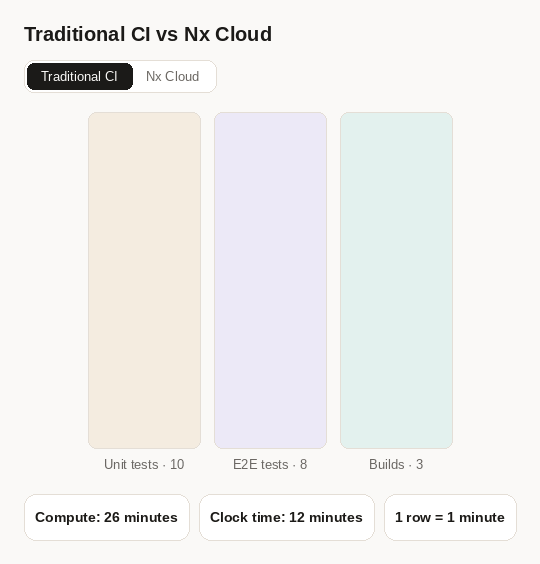
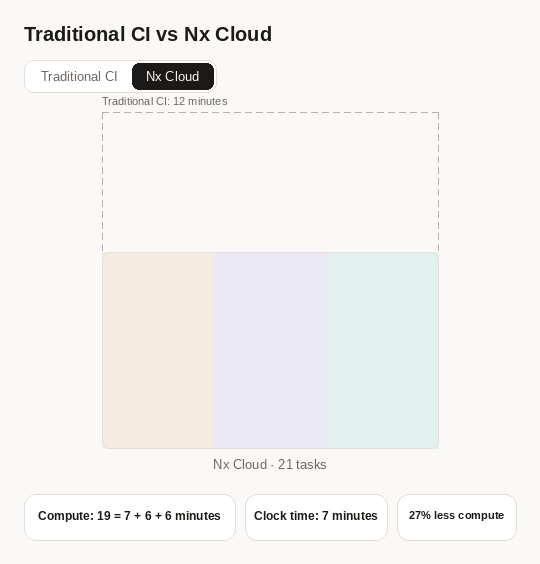

# Benchmark: Nx Cloud Platform vs Nx Using Remote Cache Only

Recent changes to the Nx Cloud platform significantly increase the cache hit rate and
reduce compute, while also making CI much faster. This benchmark demonstrates the impact
and explains where the savings come from.

Across the weighted mix of measurements below, Nx Cloud completes CI **10.6x faster** and
uses **78.7% less compute** than GitHub Actions using remote cache alone. Excluding setup
and cleanup, validation is **12.2x faster** and uses **78.1% less compute**.

## The workspace

The repository is a synthetic but realistically shaped monorepo.

|                                   | Count |
| --------------------------------- | ----- |
| Projects                          | 511   |
| Feature libraries                 | 302   |
| UI libraries                      | 130   |
| Utility libraries                 | 70    |
| Applications and support projects | 9     |

## The tasks

A full CI run executes 1,634 tasks.

| Target        | Tasks | Notes                                                    |
| ------------- | ----- | -------------------------------------------------------- |
| typecheck     | 510   | one per library                                          |
| lint          | 510   | one per library                                          |
| test          | 507   | Vitest, one per library                                  |
| e2e-ci slices | 100   | one Playwright spec per task                             |
| build         | 3     | only the two applications and the products package build |
| validate      | 1     | simulates a CI check that is not project specific        |

Some tasks have to run in a particular order:

- Applications must be built before e2e tests can run, because the tests exercise the
  built artifacts through a preview server.
- Typechecks run in dependency order so they do not consume extra CPU and RAM.
- E2E tests run one at a time on each worker, simulating a shared resource on that worker.

Note that real repositories often have many more dependencies between tasks, for example,
when they contain many buildable libraries. Nx Cloud does even better in those cases because it freely moves
tasks between agents to get optimal performance.

Everything is supposed to represent a mid-size monorepo used to build an application or a platform.

## The three scenarios

The benchmark covers three types of change:

- **Full rebuild** — a global change, so every task in the graph reruns.
- **Large change** — a shared UI library changes, invalidating a large slice of the graph.
- **Small/feature change** — a single feature library changes (a typical pull request).
  The current Nx Cloud measurement is still the earlier test-only edit.

Four numbers are reported for each run:

- **Clock:** wall time including setup and cleanup, excluding queue time.
- **Clock validation:** wall time spent in the validation commands, excluding setup and cleanup.
- **Compute:** total VM-minutes across the main job and workers, including setup and cleanup.
- **Compute validation:** VM-minutes during validation, excluding setup and cleanup.

All values below are in minutes. Compute is raw VM time, not CPU-minutes, rounded billing
minutes, or a dollar cost. For the baseline, clock is the longest job duration and validation
clock is the longest per-job sum of Nx command steps. For Nx Cloud, validation spans the
concurrent checks and includes worker time within that window.

## Baseline: remote cache only

[nrwl/cache-dte-bench](https://github.com/nrwl/cache-dte-bench) is the same repository
using only remote caching, without Nx agents, Nx Ultracache or distributed task execution. This baseline
has the same performance characteristics as a DIY caching solution, and it uses
one VM per task type: build, typecheck, lint, test, e2e and validate.

| Scenario | Clock | Clock validation | Compute | Compute validation |
| --- | ---: | ---: | ---: | ---: |
| [Full rebuild](https://github.com/nrwl/cache-dte-bench/actions/runs/41850764305) | 60.87 | 59.28 | 128.85 | 120.08 |
| [Large change](https://github.com/nrwl/cache-dte-bench/actions/runs/41850758083) | 46.02 | 44.53 | 85.68 | 74.08 |
| [Feature change](https://github.com/nrwl/cache-dte-bench/actions/runs/41850764136) | 46.77 | 45.27 | 59.60 | 49.53 |

## Nx Cloud

| Scenario | Clock | Clock validation | Compute | Compute validation |
| --- | ---: | ---: | ---: | ---: |
| [Full rebuild](https://snapshot.nx.app/cipes/6aeb9328dadc7bad4d2ea9bf/overview?runGroup=6aeb9328dadc7bad4d2ea9bd-main) | 12.90 | 12.05 | 85.75 | 80.15 |
| [Large change](https://snapshot.nx.app/cipes/6aeb9325dadc7bad4d2ea9b1/overview?runGroup=6aeb9324dadc7bad4d2ea9af-main) | 9.08 | 8.42 | 39.87 | 36.43 |
| [Small change — test-only](https://snapshot.nx.app/cipes/6aeb98ae2e07faac9367beb3/overview?runGroup=6aeb98ad2e07faac9367beb1-main) | 3.12 | 2.42 | 5.92 | 4.55 |

Compute includes the main job and dedicated workers.

| Scenario | Wall-time speedup vs GHA | Compute reduction vs GHA |
| --- | ---: | ---: |
| Full rebuild | 4.7x | 33.4% |
| Large change | 5.1x | 53.5% |
| Small change — test-only | 15.0x | 90.1% |
| **Weighted average** | **10.6x** | **78.7%** |

## Weighted results

The overall savings depend on how often each kind of change occurs, and that ratio differs
between repositories. This comparison assumes **80% small/feature changes, 17% large changes,
and 3% full rebuilds**.

Each metric is weighted independently: `0.80 × small + 0.17 × large + 0.03 × full`.
Speedups and reductions are then calculated from those weighted totals, not by averaging
scenario speedups. The small-change measurement caveat above applies to these totals.

| Runner | Clock | Clock validation | Compute | Compute validation |
| --- | ---: | ---: | ---: | ---: |
| GHA | 47.07 | 45.56 | 66.11 | 55.82 |
| Blacksmith | 47.08 | 44.95 | 67.32 | 53.73 |
| **Nx Cloud** | **4.42** | **3.73** | **14.09** | **12.24** |

| Compared with | Wall-time speedup | Compute reduction | Validation speedup | Validation compute reduction |
| --- | ---: | ---: | ---: | ---: |
| GHA | **10.6x** | **78.7%** | **12.2x** | **78.1%** |
| Blacksmith | **10.6x** | **79.1%** | **12.1x** | **77.2%** |

It is possible to make a manually configured CI pipeline faster by allocating more compute.
The aim here is to reduce both wall time and total VM time through more precise caching
and task distribution.

## How did we achieve this?

Two core mechanisms produce these savings:

- Ultracache
- Task distribution with dynamic compute packing

**Ultracache.** Nx Cloud instruments CI executions to learn what each task reads and
writes, down to every single file. That is far more precise than a conservative declaration
of everything a task might read. Combined with splitting tests into individual targets, it
makes each test independently cacheable, which drastically lowers p80. Another benefit is
that the cache configuration is always correct. Ultracache is a more advanced version of the
cache and requires Nx Cloud's task distribution.

**Task distribution with dynamic packing.** Nx Cloud learns how long each task takes and
what its CPU and RAM profile is. It understands critical paths and schedules work to
minimize wall-clock time. For instance, it can start the e2e tests that have to run one at a
time, then pack the rest of the VM with other tasks.

The core intuition is that you pay for VM minutes, not for how hard the VM works. As a
result, most CI executions either have low average CPU and RAM usage, often 20% of
capacity, or they run into out-of-memory errors and CPU throttling. That is what happens
when you set the parallelism flag by hand. You experiment with it until performance is
decent and CI is stable. As workspaces evolve, those settings often become outdated
and are lowered.

With Nx Cloud, you set nothing. It knows which tasks run in what order, which tasks
can coexist on the same agent, and how much each one consumes, so it assigns work
dynamically to keep VMs near capacity, which means fewer VM minutes.

This visualization illustrates traditional CI versus Nx Cloud:

Nx Cloud:

You can see the task allocation across all agents during a full rebuild:

The number of concurrent tasks changes based on capacity. Toward the end, fewer tasks run
concurrently because the remaining e2e tests must run serially on each worker.

Another reason Nx Cloud saves so much compute is that it knows
how much compute each CI execution will need. It can assess which tasks will be cache hits,
which will miss, and which will run. It uses this information to provision an appropriate number of
workers/VMs. This is an important insight: the number of VMs needed for a CI execution can differ
by 10x between small and large PRs. Assessing this and provisioning the right amount of compute
reduces waste and lowers costs.

## What if my workspace is messy?

Both mechanisms, and the rest of Nx Cloud, help more in messy real world workspaces than in
a clean benchmark. In a real workspace, your tasks have messy dependencies, so your manual
cache configuration tends to be a lot more conservative, while Ultracache always picks up
exactly what you need.

A real workspace also has many more dependencies between tasks, and those tasks have very
different CPU and RAM profiles. So your parallelism setting has to account for the largest tasks in the set,
which can easily consume 10x more RAM or CPU.

No matter how messy tasks are, Nx Cloud partitions them into
smaller units, runs them in the right order, and packs VMs to their limits.
So the parallelism changes dynamically.

Because this benchmark is artificial and uniform (to make it easier to understand),
that messiness is not there, so the baseline performs better here than it would in practice.

## Blacksmith numbers

The baseline pull requests also ran on Blacksmith. In these measurements, full-rebuild
wall time falls from 60.87 minutes on GHA to 55.82 minutes on Blacksmith. The feature-change
run takes 46.77 minutes on GHA and 46.10 minutes on Blacksmith; its long e2e run limits the
benefit of a faster runner.

| Scenario | Clock | Clock validation | Compute | Compute validation |
| --- | ---: | ---: | ---: | ---: |
| [Full rebuild](https://github.com/nrwl/cache-dte-bench/actions/runs/41850764156) | 55.82 | 54.27 | 131.65 | 110.80 |
| [Large change](https://github.com/nrwl/cache-dte-bench/actions/runs/41850758075) | 50.12 | 44.37 | 83.52 | 69.60 |
| [Feature change](https://github.com/nrwl/cache-dte-bench/actions/runs/41850763983) | 46.10 | 44.72 | 61.47 | 48.22 |

Nx Cloud against Blacksmith:

| Scenario | Wall-time speedup | Compute reduction |
| --- | ---: | ---: |
| Full rebuild | 4.3x | 34.9% |
| Large change | 5.5x | 52.3% |
| Small change — test-only | 14.8x | 90.4% |
| **Weighted average** | **10.6x** | **79.1%** |

Using the same 80/17/3 mix, Nx Cloud's weighted wall time is **4.42 minutes** versus
**47.08 minutes** for Blacksmith, using **14.09 VM-minutes** versus **67.32 VM-minutes**.
The pending small feature-edit measurement still needs to replace the test-only result.

VM-minute savings do not translate directly to dollar savings across providers:
compare each provider's machine sizes and pricing separately.

The benchmark uses a JavaScript monorepo. If your monorepo includes, for example, a Rust
component, Blacksmith's numbers will be better than GHA's, but still not as good as Nx Cloud's.
